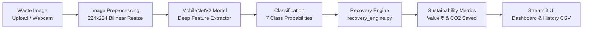

# ♻️ AI-Based Waste to Recovery System

[](https://www.python.org/)
[](https://www.tensorflow.org/)
[](https://streamlit.io/)
[](https://docs.pytest.org/)
[](LICENSE)

An intelligent computer vision and circular economy platform that classifies waste items from images in real time, prescribes optimal recovery pathways (Recycling, Composting, Safe Disposal), and quantifies financial recovery value (₹ INR) and carbon offset (kg CO₂).

---

## 🌟 Key Features

- **🎯 Deep Learning Classification**: Powered by a transfer-learning MobileNetV2 architecture trained across 7 waste categories.
- **♻️ Actionable Recovery Engine**: Recommends immediate disposal routes, color-coded bin sorting, and step-by-step processing instructions.
- **🌱 Environmental & Economic Analytics**: Automatically computes estimated recovery value in INR (₹) and CO₂ emissions saved for any waste weight.
- **📈 Interactive Web Dashboard**: Streamlit interface with webcam capture, drag-and-drop image uploads, confidence score distributions, and prediction logs.
- **🧪 Automated Test Suite**: Built-in unit test coverage with `pytest` for preprocessing, recommendation rules, and history persistence.

---

## 🏗️ System Architecture



---

## 📋 Waste Categories & Recovery Matrix

| Category | Recovery Method | Bin Color | Value (₹/kg) | CO₂ Saved (kg/kg) | Primary Action |
|:---|:---|:---:|:---:|:---:|:---|
| 📦 **Cardboard** | Recycle | 🔵 Blue | ₹11.00 | 1.20 kg | Flatten, remove tape, bale for pulping |
| 🍾 **Glass** | Recycle | 🟢 Green | ₹16.00 | 1.50 kg | Separate by color, crush, melt for reuse |
| 🥫 **Metal** | Recycle | 🟡 Yellow | ₹42.00 | 2.80 kg | Segregate ferrous/non-ferrous for smelting |
| 🍎 **Organic** | Compost | 🟤 Brown | ₹9.00 | 2.20 kg | Aerate with carbon-rich material for soil enrichment |
| 📄 **Paper** | Recycle | 🔵 Blue | ₹14.00 | 1.30 kg | Pulp and de-ink for recycled paper production |
| 🧴 **Plastic** | Recycle | 🟠 Orange | ₹18.00 | 1.80 kg | Sort by resin code (PET/HDPE/PP), shred & pelletize |
| 🗑️ **Trash** | Safe Disposal | ⚪ Grey | ₹1.00 | 0.20 kg | Isolate non-recyclables for approved landfill |

---

## 📂 Project Structure

```text
AI_Waste_Recovery_System/
├── app.py                     # Streamlit frontend & interactive dashboard
├── train_model.py             # Transfer learning training pipeline (MobileNetV2)
├── recovery_engine.py         # Business logic for recovery steps & value calculation
├── requirements.txt           # Python dependency specifications
├── class_names.json           # Trained class label registry (7 classes)
├── waste_model.h5             # Saved Keras/TensorFlow model weights
├── best_waste_model.h5        # Checkpointed best validation weights
├── history.csv                # Persistent log of user classifications
├── training_history.png       # Training & validation loss/accuracy curves
├── confusion_matrix.png       # Model evaluation confusion matrix
├── dataset/                   # Dataset directory partitioned by class
│   ├── cardboard/
│   ├── glass/
│   ├── metal/
│   ├── organic/
│   ├── paper/
│   ├── plastic/
│   └── trash/
├── sample_images/             # Sample images for testing out of the box
│   └── sample_waste.jpg
└── tests/                     # Automated unit test suite
    ├── test_history.py
    ├── test_preprocessing.py
    └── test_recovery_engine.py
```

---

## 🚀 Quickstart Guide

### 1. Prerequisites
- **Python 3.10 or 3.11** (TensorFlow 2.15 is fully optimized for Python 3.10/3.11).

### 2. Clone and Setup Environment

```bash
# Clone the repository
git clone https://github.com/sreesanth-727/AI_Waste_Recovery_System.git
cd AI_Waste_Recovery_System

# Create virtual environment
python -m venv .venv

# Activate on Windows PowerShell:
.\.venv\Scripts\Activate.ps1
# (Or on Linux / macOS):
# source .venv/bin/activate

# Install required dependencies
pip install -r requirements.txt
```

> **PowerShell Execution Policy Tip**:
> If Windows blocks script activation, run:
> ```powershell
> Set-ExecutionPolicy -Scope Process -ExecutionPolicy Bypass
> .\.venv\Scripts\Activate.ps1
> ```

---

### 3. Run the Web Application

Launch the Streamlit web application:

```bash
streamlit run app.py
```

*Or directly without activating virtualenv:*
```powershell
.\.venv\Scripts\streamlit.exe run app.py
```

Open your browser at **`http://localhost:8501`**.

---

### 4. Train the Model (Optional / Custom Data)

To retrain the MobileNetV2 classifier on your dataset:

```bash
python train_model.py
```

This workflow:
- Validates the class structure in `dataset/`
- Performs stratified train/val/test splitting
- Applies data augmentation (rotations, flips, zoom, contrast)
- Trains top layers followed by fine-tuning the base MobileNetV2 network
- Evaluates test performance and exports `waste_model.h5`, `confusion_matrix.png`, and `training_history.png`

---

### 5. Run Automated Tests

Execute the unit test suite with `pytest`:

```bash
pytest tests/ -v
```

---

## 💡 How It Works

1. **Input**: Upload an image (`.jpg`, `.jpeg`, `.png`) or snap a photo directly from your webcam.
2. **Preprocessing**: Automatically converts color channels and scales input to 224×224 pixels with bilinear interpolation.
3. **Inference**: MobileNetV2 predicts class probabilities with top-class confidence percentage.
4. **Recommendation**: The Recovery Engine identifies the appropriate bin color, disposal protocol, and recovery method.
5. **Impact Estimation**: Enter the item weight (kg) to calculate real-time financial value (₹) and CO₂ emissions avoided.
6. **Persistence**: Saves records to `history.csv` for aggregate analytics and trend visualization in the dashboard.

---

## 🎓 Viva & Technical Q&A

<details>
<summary><strong>1. Why is MobileNetV2 selected over heavier architectures like ResNet50 or VGG16?</strong></summary>
<br/>
MobileNetV2 employs depthwise separable convolutions and inverted residual bottlenecks, drastically lowering parameter count and FLOPs while retaining high representation power. This makes it ideal for real-time edge or web browser inference on modest hardware without dedicated GPUs.
</details>

<details>
<summary><strong>2. How does Transfer Learning benefit this project?</strong></summary>
<br/>
Rather than training a convolutional network from scratch on small datasets (which leads to severe overfitting), transfer learning leverages pre-trained ImageNet weights for general visual representations (edges, textures, shapes), fine-tuning only the downstream layers for waste classification.
</details>

<details>
<summary><strong>3. What role does the Recovery Engine play?</strong></summary>
<br/>
Raw classification yields only a category label. The Recovery Engine translates that label into circular economy value: specific segregation rules, municipal bin codes, market scrap rate valuations, and avoided landfill greenhouse gas emissions.
</details>

<details>
<summary><strong>4. How is data leakage prevented during dataset preparation?</strong></summary>
<br/>
Dataset splitting is performed before batching with fixed seeds, ensuring stratified, disjoint partitions between training, validation, and testing. Image augmentation is strictly isolated to the training split.
</details>

---

## 📄 License

This project is licensed under the [MIT License](LICENSE) — free for educational, academic, and non-commercial development.
